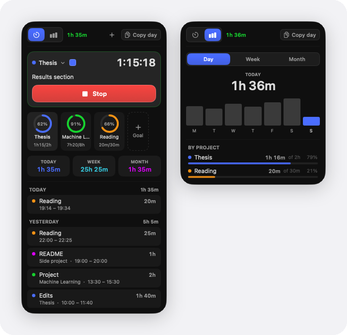

# TrackerLite

A native macOS menu-bar time tracker. One click starts and stops the clock; the
panel shows your day, week, and month. SwiftUI + AppKit, no dependencies, no
accounts, no permissions.

<p align="center">
  
</p>

## Features
- **One click in, one click out.** The icon turns green with the running session's
  elapsed `h:mm`; idle, it shows today's total. Right-click to start/stop without
  opening the panel.
- **Track** — live clock, a project chip (pick, add, recolor, archive), and an
  editable "what are you working on?" note. Below: Today · Week · Month, and the
  last 14 days of sessions grouped by day. Sessions sharing a project and note
  merge into one row, so a day of stop/start taps stays one line.
- **Stats** — Day / Week / Month: a total, a trend chart, and a by-project
  breakdown with share bars.
- **Auto-stop** — the clock stops after 2 minutes of mouse and keyboard silence,
  backdated to your last input so idle time isn't counted. Toggle in the
  right-click menu.
- **Honest numbers** — sessions crossing midnight split across days, sub-5-second
  taps are discarded as misclicks, and the running session survives a quit,
  crash, or sleep.
- **Edit and log sessions** — click a session to fix its project, note, day or
  times; click the running clock to move its start; **+** logs a session you
  never started the clock for. Overlaps are flagged.
- **Switch project mid-session** — the session ends and a new one starts.
- **Goals** — a daily or weekly target per project (weekdays-only optional), shown
  as rings on the Track tab with a streak count.
- **⌃⌥T** starts and stops the clock from anywhere (no Accessibility needed).
- **Export CSV** — this week, this month or all time, from the right-click menu.
- **Copy summary** — the 📄 button copies the period's breakdown as plain text.

## Build
Requires **macOS 26 + Xcode 26** (uses the Liquid Glass `NSGlassEffectView` API).

```bash
./Scripts/build-app.sh
open dist/TrackerLite.app
```

`open dist/TrackerLite.app --args --demo` runs it on made-up sample data and never
touches your real data file. `swift Scripts/toggle-panel.swift [track|stats]`
opens a tab without clicking.

It adds itself as a login item on first launch; turn that off in the right-click
menu.

## Data
One hand-editable JSON file in your iCloud Drive (or `~/Library/Application
Support/TrackerLite/` without it):

```
~/Library/Mobile Documents/com~apple~CloudDocs/TrackerLite/data.json
```

`{ projects: [{id, name, colorIndex, colorHex?, archived, goalMinutes?, goalPeriod?, updated?}],
sessions: [{id, projectID, note, start, end, updated?}], deletedSessions: {id: date} }`
— `end: null` is the running session. Writes are atomic; an unreadable file is
backed up to `data.corrupt.json` rather than clobbered. Right-click the icon ▸
**Reveal Data File**.

Every Mac on the same iCloud shares it and picks up the other's changes live.
Copies merge record by record — sessions from both Macs are kept, the newer
edit wins, deletions stick — and if timers run on two Macs at once, the newer
ends the older where it began, so nothing counts twice.

© 2026 Ryan Truong. All rights reserved: the source is public to read, not to copy or reuse. See [LICENSE](LICENSE).
